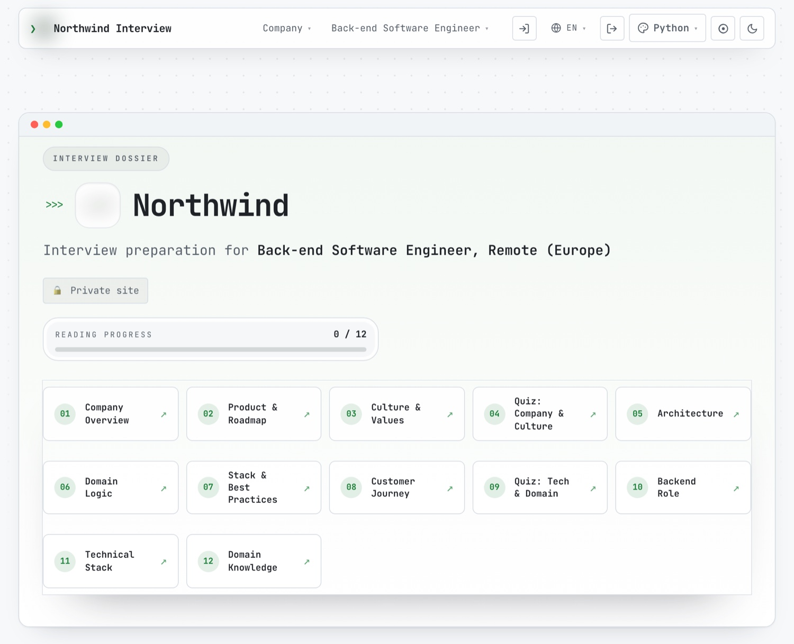
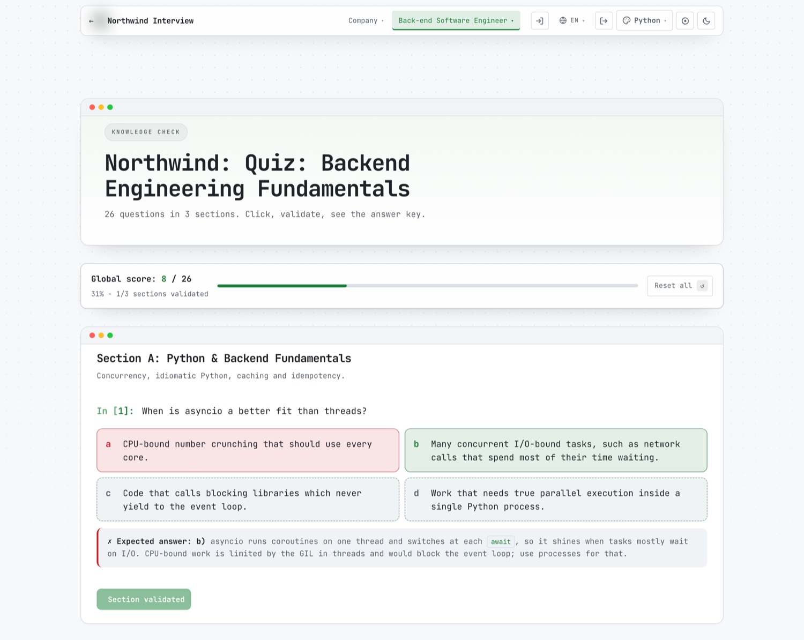

# Interview Challenger

Preparation for one specific job interview, built from the offer itself.

Paste the link to a job offer and you get a private site about that company and
that role: the pages worth reading, and graded quizzes that tell you where you
actually stand. Password-protected, editable in place, in up to three languages.

- **Not a question bank.** Everything is derived from the offer and the company's
  public pages.
- **Not a live copilot.** It prepares you before the interview; it does not
  assist during it.

Closed beta, twenty seats: https://www.interviewchallenger.com

The source is private while the beta runs. Write to hello@interviewchallenger.com.
